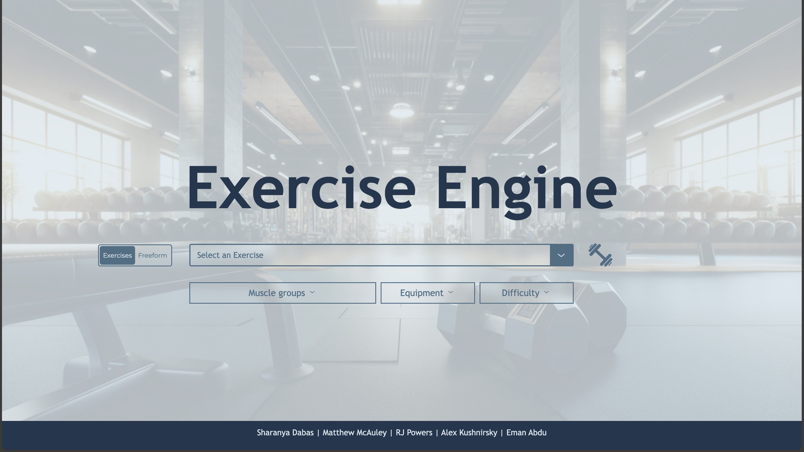
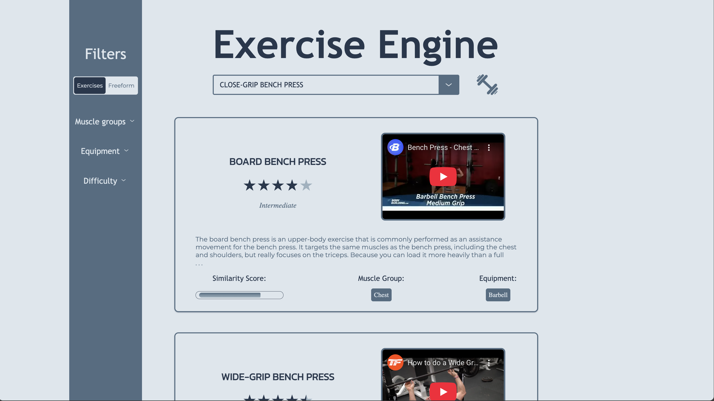
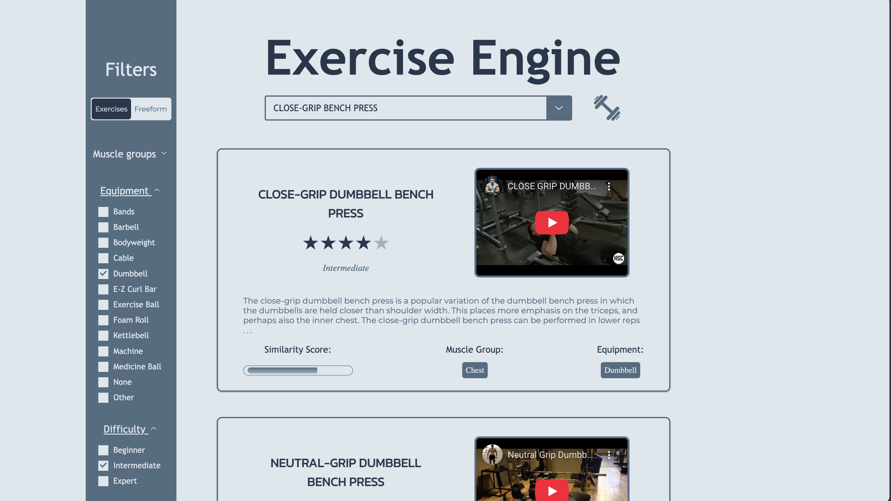
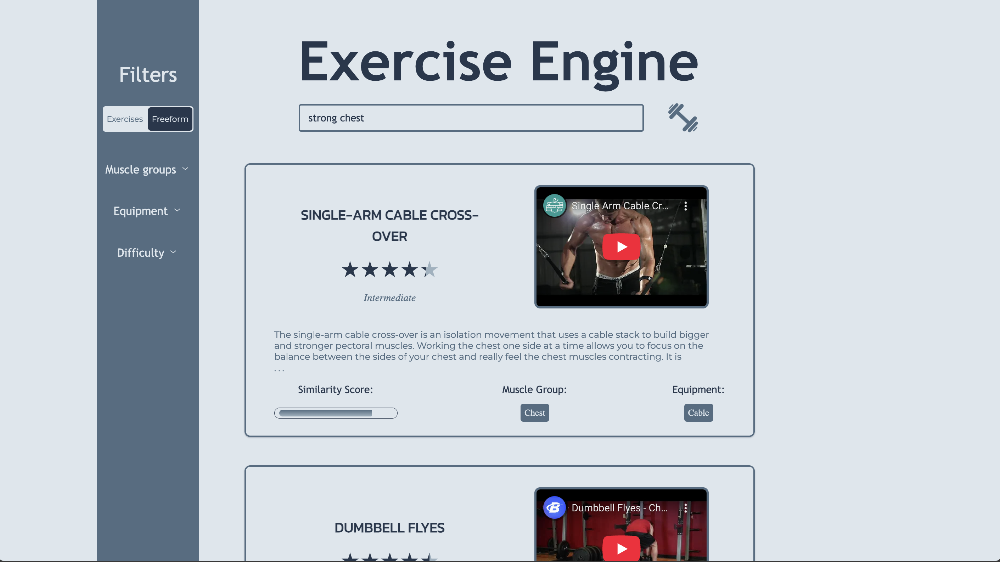

# Exercise Engine

## Contents

- [Description](#description)
- [Online Hosting](#online-hosting)
- [Images](#images)
- [Running Locally](#running-locally)
- [Author](#author)

## Description

This was a class project for **CS/INFO 4300 at Cornell University** where I worked on a 5-person software development team with other students. For the second half of the semester, we were tasked with building any information retrieval system of our choosing. Based on my passion for personal fitness I suggested we create a full-stack website that allows the user to query an exercise and receive the most similar results. Our website is capable of taking in drop-down or ad-hoc (freeform) queries by the user and permits filtering based on muscle group, difficulty, and equipment used.

The frontend of our website is done in static HTML, CSS, and JS which is designed as a template for our flask backend to server side render. The templates provide the functionality for the user to send information to the backend, apply filters, and display the returned results in an aesthetically pleasing way. There is no processing or calculations done on the frontend, as we decided to leave all of that to the backend. We have two templates, one for the home page which is initially shown to the user and one for the results page which is what the user interacts with after their first query.

The backend of our website is a python app built using the Flask framework. It loads our Selenium-webscraped JSON dataset and performs SVD text-mining on it, which was one of the main methods we learned in class for building an effective IR system. It then uses cosine similarity between document embeddings to return the top 5 most similar results that fit within the filters provided by the frontend. For the drop-down querying, it uses a document-document similarity matrix to determine the most similar exercises to the one picked from the dataset. For the ad-hoc querying, it uses a term-document similarity matrix to determine the most similar exercises to the words in the query. The JSON response returned to the frontend also contains the exercise description, muscle groups, equipment used, most relevant YouTube search, and similarity score. The reviews displayed are crowdsourced from [bodybuilding.com](https://bodybuilding.com).

We decided to use web scraping to acquire our dataset because we had difficulty finding any pre-existing datasets that were suitable for our project on websites such as kaggle. Our professor prohibited simple table lookups such as returning exercises that used the same body part, and we instead had to do some sort of text mining. Web Scraping allowed us to get a decent sized corpus of exercises with long enough descriptions such that SVD could effectively be run on them to create meaningful semantic embeddings. However, the descriptions were not as long as we would have liked for many of them and this lead to some poor results. For comparing other datasets such as books, there is an extensive amount of text to work with and the SVD embeddings are much more effective. This was the biggest roadblock we faced, and we never came to an effective solution for where to source good descriptions from because most are proprietary.

Once the class concluded, I decided that it would be a fun exercise to fork and try and host on the cloud. I created a Dockerfile to containerize the project and familiarized myself with building images and running containers as well as pushing to Docker Hub. I also learned about using AWS to create an EC2 VM instance and how to SSH into it to run the container. I installed Docker and Docker Compose on the instance so that I was able to pull down the image and run the container. After opening the necessary ports and configuring the security group, I was able to access the website from any local machine through the public IP address. After my AWS free tier subscription concluded, I hosted it on an Oracle Cloud always free instance.

## Online Hosting
The website is hosted at [https://exerciseengine.fit](https://exerciseengine.fit).

## Images

#### Home Page


#### Results Page


#### Filters


#### Freeform Query


## Running locally

#### Step 1: Download the source code
Clone or download a zip file of the source code onto your device

#### Step 2: Set up a virtual environment
Create a virtual environment in Python (or using conda if more familiar):

Run `python -m venv <virtual_env_name>` in your project directory to create a new virtual environment, remember to change <virtual_env_name> to your preferred environment name.

#### Step 3: Install dependencies
You need to install dependencies by running `python -m pip install -r requirements.txt` in the backend folder.

#### Step 4: Command to run project locally:
```python backend/app.py```

## Author

<div align="center">

### Matt McAuley

<table align="center" style="border: none; border-collapse: collapse; margin: 0 auto; margin-top: -6px; margin-bottom: 14px; width: 440px;">
  <tr style="border: none;">
    <td align="right" style="border: none; padding: 0 10px 0 0; width: 50%; white-space: nowrap;">Software Engineer</td>
    <td style="border: none; padding: 0; width: 1px; color: #888;">|</td>
    <td align="left" style="border: none; padding: 0 0 0 10px; width: 50%; white-space: nowrap;">Cornell Computer Science</td>
  </tr>
</table>

[](https://mattmcauley.com)&nbsp;&nbsp;
[](mailto:mwm223@cornell.edu)&nbsp;&nbsp;
[](https://github.com/matt-mcauley)

</div>


